# Lab 02: SQLite Database and CRUD Routes

## Student Information

- **Student Name:** CHEVALA VENKATESWARARAO
- **Registration Number:** 252U1R1058
- **Section:** CSE-2A
- **Course:** Backend Development Fundamentals (Year II Term II)

---

## Repository and Deployment

- **GitHub Repository:** https://github.com/venkateswararaochevala2-cpu/Backend-Development-lab-02
- **Live Deployment URL:** Pending deployment
- **Local API URL:** http://localhost:3000

---

## 1. Project Description

This project connects an Express.js server to an SQLite relational database and implements five REST API endpoints to perform CRUD operations on book records.

CRUD stands for:

- **Create:** Add a new book.
- **Read:** Retrieve all books or a specific book.
- **Update:** Modify an existing book.
- **Delete:** Remove a book from the database.

The application uses asynchronous database operations with `async/await`, parameterized SQL queries with `?` placeholders, input validation, and appropriate HTTP status codes.

---

## 2. Technologies Used

| Technology | Purpose |
|---|---|
| Node.js | JavaScript runtime environment |
| Express.js | Backend web framework |
| SQLite | Relational database |
| sqlite3 | SQLite database driver |
| sqlite | Promise-based SQLite wrapper |
| Nodemon | Automatically restarts the server during development |
| Postman | API testing |
| SQLite CLI | Database inspection and verification |

---

## 3. Project Structure

```text
backend-lab-2/
│
├── node_modules/
├── screenshots/
│   ├── 01-dependencies.png
│   ├── 02-server-running.png
│   ├── 03-home-page.png
│   ├── 04-browser-books.png
│   ├── 05-get-all-books.png
│   ├── 06-get-one-book.png
│   ├── 07-post-book.png
│   ├── 08-put-book.png
│   ├── 09-delete-book.png
│   ├── 10-verify-deleted-book.png
│   ├── 11-database-schema.png
│   ├── 12-database-records.png
│   ├── 13-database-count.png
│  
│
├── .gitignore
├── .node-version
├── app.js
├── books.db
├── database.js
├── package.json
├── package-lock.json
└── README.md
```

**Note:** The `node_modules/` directory is generated by npm and should not be committed to GitHub.

---

## 4. Database Schema

The project uses an SQLite database named `books.db`, located in the root directory alongside `app.js`.

The database contains a table named `book`.

### Table Structure

```sql
CREATE TABLE book (
    id INTEGER PRIMARY KEY,
    title TEXT,
    author TEXT,
    price INTEGER,
    pages INTEGER
);
```

### Database Fields

| Column | Data Type | Description |
|---|---|---|
| id | INTEGER | Primary key |
| title | TEXT | Book title |
| author | TEXT | Book author |
| price | INTEGER | Book price |
| pages | INTEGER | Number of pages |

The database contains 10 initial sample book records.

### SQLite CLI Commands

Open the project terminal and execute:

```bash
sqlite3 books.db
```

Useful database commands:

```sql
.tables
.schema book
PRAGMA table_info(book);
SELECT * FROM book;
SELECT COUNT(*) FROM book;
```

Exit SQLite:

```sql
.quit
```

### Database Screenshots

**Table Schema**

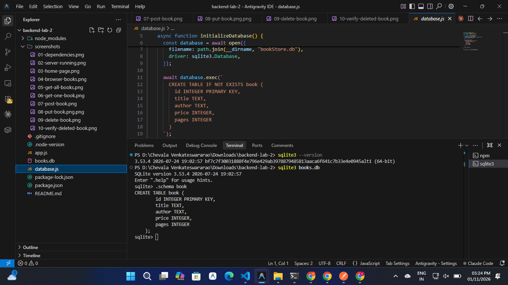

**All Book Records**

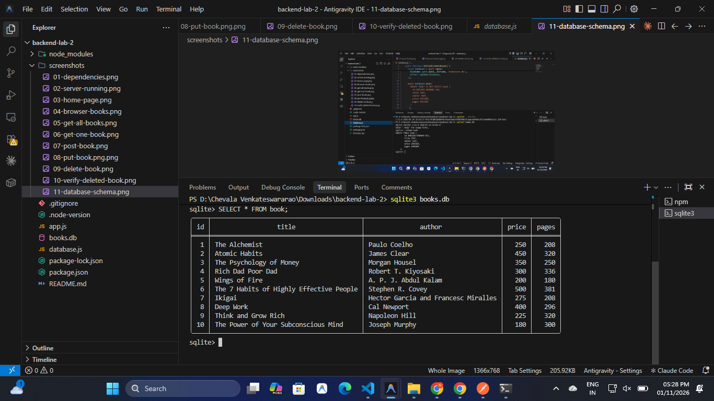

**Total Book Count**

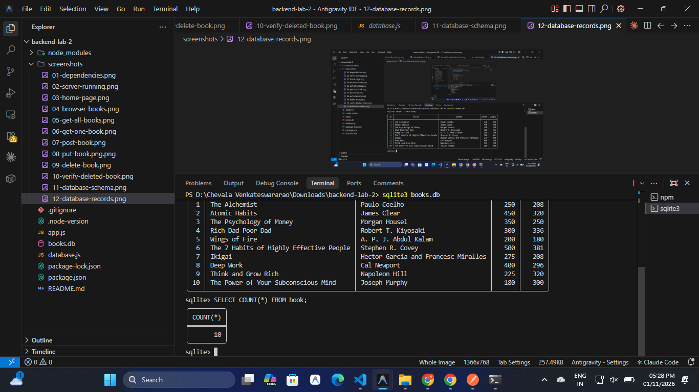

---

## 5. Installation and Setup

### Prerequisites

Install the following software:

- Node.js 20.18.0
- npm
- VS Code
- Postman
- SQLite command-line tools

### Step 1: Clone the Repository

```bash
git clone https://github.com/venkateswararaochevala2-cpu/Backend-Development-lab-02.git
```

### Step 2: Navigate to the Project Folder

```bash
cd Backend-Development-lab-02
```

If your repository contains this lab inside another folder, navigate to the actual `backend-lab-2` directory.

### Step 3: Install Dependencies

```bash
npm install
```

### Step 4: Verify Installed Packages

```bash
npm list --depth=0
```

### Step 5: Check Node.js Version

```bash
node -v
```

Expected version:

```text
v20.18.0
```

---

## 6. Running the Application

### Development Mode

Run the application using Nodemon:

```bash
npm run dev
```

Expected terminal output:

```text
[nodemon] starting `node app.js`
Server Running at http://localhost:3000/
```

Nodemon automatically restarts the server whenever application files are modified.

### Production Mode

```bash
npm start
```

The application opens the SQLite database using `initializeDBAndServer()` and starts the Express server only after the database connection succeeds.

### Environment Variables

| Variable | Description | Default |
|---|---|---|
| PORT | Port used by the Express server | 3000 |

No environment variable is required for local development.

---

## 7. API Endpoints

**Base URL:** `http://localhost:3000`

| HTTP Method | Endpoint | Description |
|---|---|---|
| GET | `/books/` | Retrieve all books |
| GET | `/books/:bookId/` | Retrieve a specific book by ID |
| POST | `/books/` | Add a new book |
| PUT | `/books/:bookId/` | Update an existing book |
| DELETE | `/books/:bookId/` | Delete a book by ID |

### 7.1 GET All Books

- **Method:** GET
- **Endpoint:** `/books/`
- **Description:** Retrieves all books from the database.
- **Expected Status:** 200 OK

### 7.2 GET One Book

- **Method:** GET
- **Endpoint:** `/books/:bookId/`
- **Description:** Retrieves a book using its ID.
- **Expected Status:** 200 OK or 404 Not Found

### 7.3 POST a New Book

- **Method:** POST
- **Endpoint:** `/books/`
- **Description:** Inserts a new book into the database.
- **Expected Status:** 201 Created

Example JSON request:

```json
{
    "title": "The Lean Startup",
    "author": "Eric Ries",
    "price": 400,
    "pages": 336
}
```

### 7.4 PUT – Update a Book

- **Method:** PUT
- **Endpoint:** `/books/:bookId/`
- **Description:** Updates the details of an existing book.
- **Expected Status:** 200 OK

Example JSON request:

```json
{
    "title": "The Lean Startup - Updated",
    "author": "Eric Ries",
    "price": 500,
    "pages": 350
}
```

### 7.5 DELETE – Remove a Book

- **Method:** DELETE
- **Endpoint:** `/books/:bookId/`
- **Description:** Deletes an existing book using its ID.
- **Expected Status:** 200 OK

---

## 8. Postman API Testing

All five CRUD endpoints are tested using Postman.

### 8.1 GET All Books

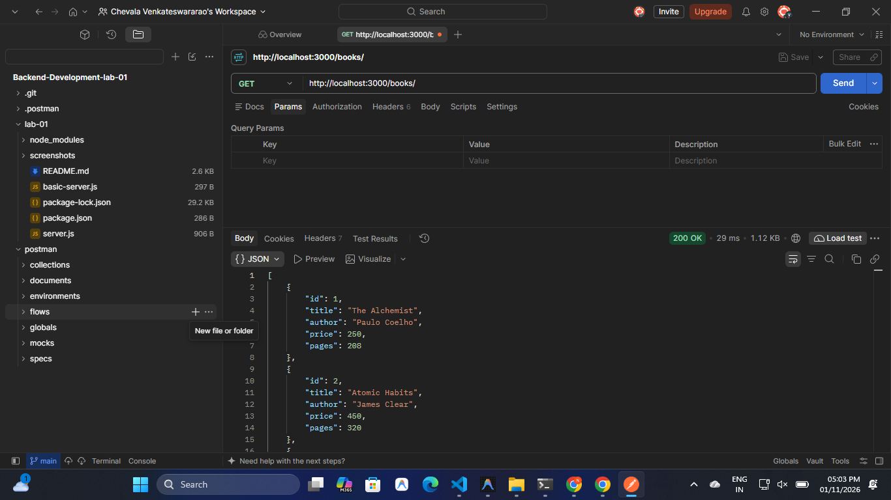

### 8.2 GET One Book

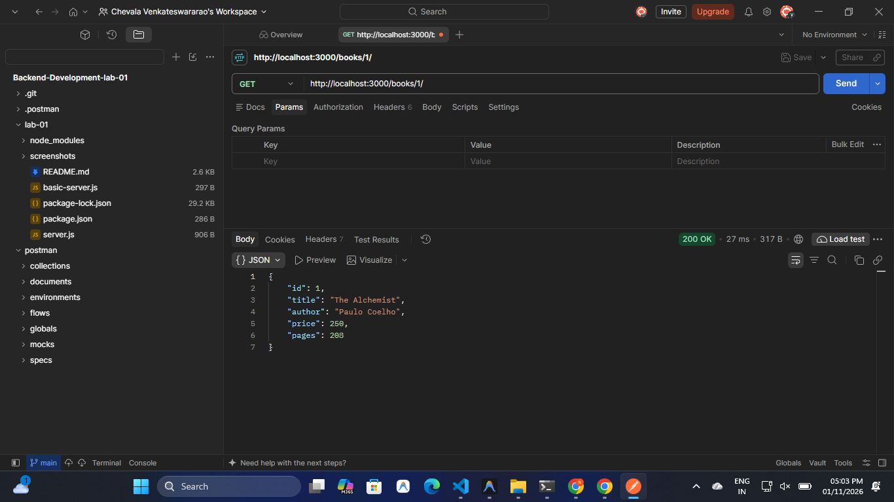

### 8.3 POST – Create a Book

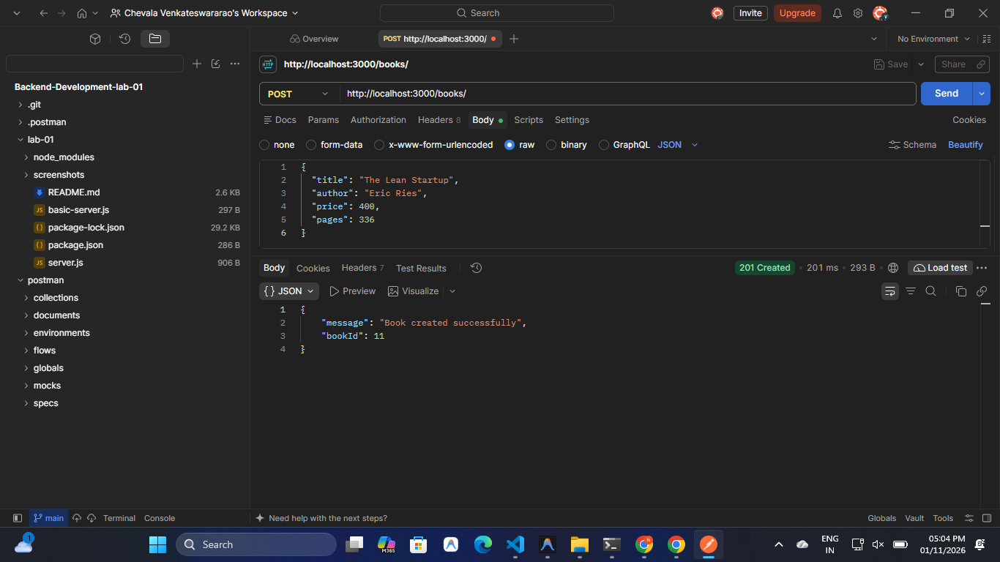

### 8.4 PUT – Update a Book


### 8.5 DELETE – Delete a Book

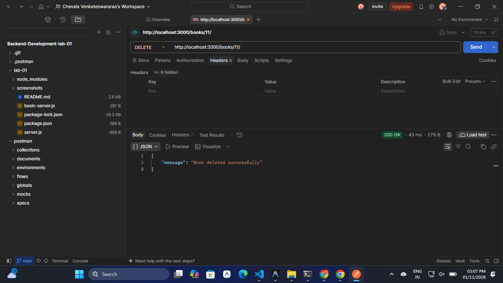

### 8.6 Verify Deleted Book

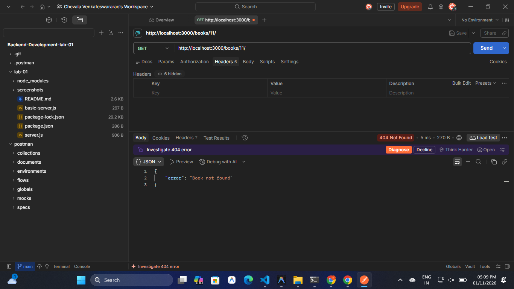

---

## 9. Application Screenshots

### Dependency Installation

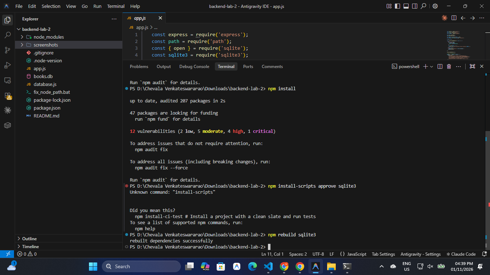

### Express Server Running

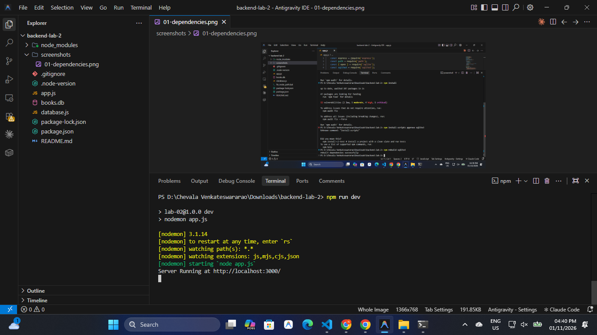

### API Welcome Page

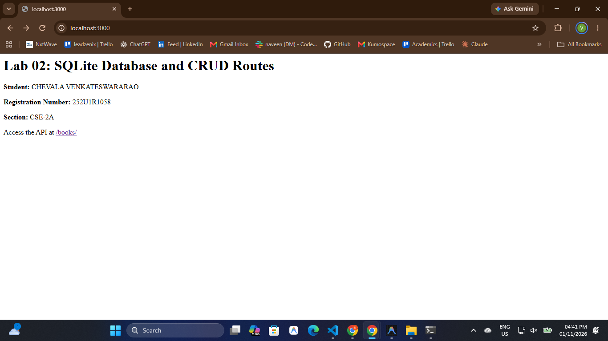

### Books API in Browser

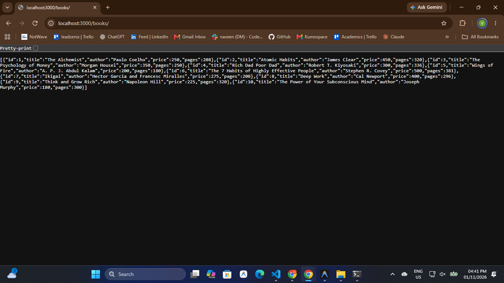

### Nodemon Automatic Restart


---

## 10. HTTP Status Codes

| Status Code | Description |
|---|---|
| 200 OK | Request completed successfully |
| 201 Created | New book created successfully |
| 400 Bad Request | Invalid or missing request data |
| 404 Not Found | Requested book or route does not exist |
| 500 Internal Server Error | Unexpected server or database error |

---

## 11. Security and Implementation

- Used parameterized SQL queries with `?` placeholders to prevent SQL injection.
- Used `async/await` for asynchronous database operations.
- Used `initializeDBAndServer()` to establish the database connection before starting the server.
- Validated request data before inserting or updating records.
- Returned appropriate HTTP status codes.
- Used Nodemon for automatic server restarts during development.

---

## 12. Learning Outcomes

Through this lab, I learned:

1. How to connect an Express.js application to an SQLite database.
2. How to create and inspect relational database tables.
3. How to insert and retrieve records using SQL queries.
4. How to implement GET, POST, PUT, and DELETE API routes.
5. How to use `async/await` for database operations.
6. How parameterized SQL queries help prevent SQL injection.
7. How to test REST APIs using Postman.
8. How to verify database changes using SQLite CLI.
9. How to use Nodemon during backend development.

---

## 13. Problems Faced and Solutions

### 1. Node.js Version Conflict

**Problem:** Windows was executing Node.js 24.16.0 instead of the required Node.js 20.18.0.

**Solution:** Installed and configured Node.js 20.18.0 using NVM for Windows and corrected the Windows Node.js configuration.

### 2. SQLite3 Native Binding Error

**Problem:** The SQLite3 native module was not available after dependency installation.

**Solution:** Corrected the Node.js version and reinstalled the dependencies, including the SQLite3 native binding.

### 3. Database Connection

**Problem:** The server should not accept API requests before the database is ready.

**Solution:** Used `async/await` in `initializeDBAndServer()` to open the database before starting the Express server.

### 4. SQL Injection Prevention

**Problem:** Directly inserting user input into SQL queries can create SQL injection vulnerabilities.

**Solution:** Used parameterized queries with `?` placeholders.

---

## 14. Deployment

**Deployment Status:** Pending.

The application is currently tested locally using:

```text
http://localhost:3000
```

The deployment URL will be added here after successful deployment.

---

## 15. Conclusion

This lab provided practical experience in backend development using Node.js, Express.js, and SQLite. I successfully implemented and tested five CRUD API endpoints, used parameterized queries, managed asynchronous database operations, and verified database records using SQLite CLI.

The project demonstrates the fundamental concepts of REST API development and relational database integration.
